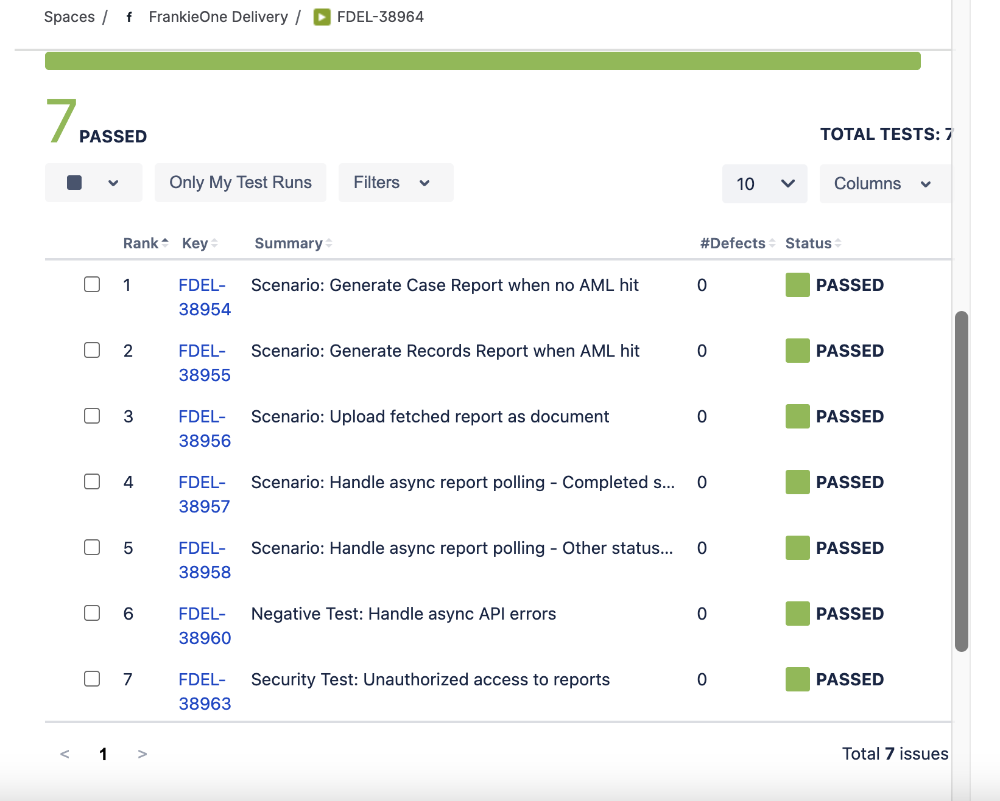

## The part of QA nobody puts on their resume

Test cases exist. They're linked to the story. And then someone — usually me — opens Jira and manually creates the execution ticket, copies the case details in, fixes the naming, links it back to the story, and does it again for the next story.

Every sprint. For every story. Ten minutes per story sounds fine until you're three sprints in and realize you've spent a day and a half on ticket clerical work. Worse: every manual ticket is slightly different. Naming drifts, steps get half-copied, and a week later nobody can tell which execution belongs to which version.

The bottleneck was never writing test cases. It was the administrative gap between "cases are ready" and "execution can start."

## What I built

A Python GitHub Action that closes that gap. You give it story IDs; it does the rest:

1. Connects to the Jira API with the credentials it's configured with
2. Fetches every test case linked to the story
3. Creates an execution ticket with all case details and steps embedded
4. Links the execution back to the story, with consistent naming and pre-configured fields
5. Optionally tags a version parameter, so release tracking stays clean

The whole flow, compressed:

```
Story IDs
   ↓
Fetch linked test cases → Prepare test data
   ↓
Create execution ticket (all test cases embedded)
   ↓
Populate steps → Link to story → Ready for QA
```

Nothing exotic — no framework, no service to run. It's an action in the same repo as the code it tests, triggered where the work already happens.

## How it fits the workflow

The action is one step in a chain that was already half-automated:

1. Story gets written with acceptance criteria
2. Test cases get generated and linked to the story (I built a separate AI test-case generator for this part)
3. The action fires and the execution ticket appears, complete
4. QA executes and records results on that ticket

Before this, steps 3 and 4 were separated by copy-paste. Now they're separated by a trigger.

## What it doesn't do

Worth being explicit, because tools like this get oversold:

- It creates execution tickets. It does not run tests or report results — execution is still human
- It's a GitHub Action with configuration, not a product. No UI, no queue, no multi-cloud story
- It trusts its credentials and its Jira project setup; misconfigured permissions fail the workflow run, which is exactly where you'd want to notice

## What changed

Creating an execution for a story went from minutes of manual work to seconds of waiting, and — the part I actually care about — every execution ticket now has the same structure, the same links, and the same metadata. Planning overhead dropped around 90%, but the consistency is the win that compounds: dashboards parse cleanly, and onboarding a new QA member means reading one ticket instead of reverse-engineering five different conventions.

Automation here wasn't about intelligence. It was about removing a repetitive gap that sat between two systems and made both of them worse.
