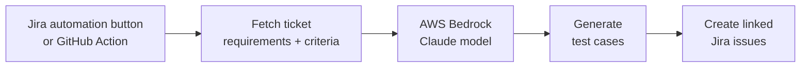

## The Problem

Our QA team spent 8-12 hours per week writing test cases manually. Every feature ticket required reading requirements, writing test steps, creating Jira issues, and linking them back. With 20+ features per sprint and 6 QA engineers, this became a bottleneck that delayed testing and created inconsistent coverage.

## What I Built

An AI-powered test case generator that creates comprehensive test cases from Jira tickets automatically.

**How it works:**
1. **Trigger**: Jira automation button or GitHub Action
2. **Fetch**: Pulls ticket data (requirements, acceptance criteria, context)
3. **Generate**: AI analyzes the ticket and generates test cases
4. **Create**: Automatically creates linked Jira issues with proper formatting

## Technical Decisions

- **AWS Bedrock**: Claude model for nuanced test case generation
- **GitHub Actions**: CI/CD integration, no infrastructure to manage
- **Prompt Engineering**: Iterated on prompts to get consistent, high-quality output across different ticket types
- **Jira API**: Deep integration with existing workflow

## Result

- <mark>Cut test-case authoring from 15 minutes to 30 seconds</mark>
- **15-25 hours saved** per sprint
- **80% reduction** in regression time
- **Consistent coverage** across all features

**Shows:** Python tooling, AWS Bedrock integration, CI/CD automation, Jira API workflows
