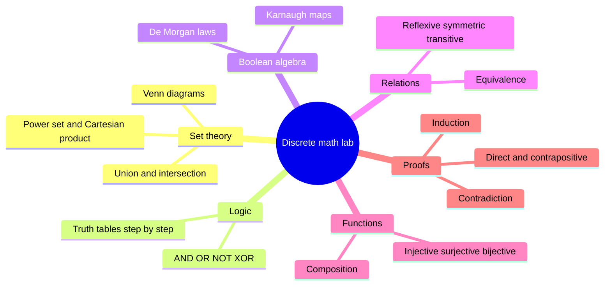

<video src="/projects/axiomara-brag.mp4" poster="/projects/axiomara-brag.jpg" controls muted playsinline preload="metadata" width="1920" height="1080"></video>

## The Problem

Discrete mathematics is abstract and hard to visualize. Students struggle with set theory, logic, and proofs because they can't see what's happening. Textbooks show static diagrams. Nothing is interactive.

## What I Built

A virtual math laboratory where abstract concepts become interactive experiences. Users manipulate sets, build logic expressions, and see the results in real-time.

**11 modules:**
- **Set Theory**: Union, intersection, difference, complement, power set, Cartesian product with interactive Venn diagrams
- **Logic**: Propositions, AND/OR/NOT/XOR/IMPLIES/BICONDITIONAL, truth tables with step-by-step evaluation
- **Boolean Algebra**: Simplification, De Morgan's laws, Karnaugh maps
- **Relations**: Reflexive, symmetric, transitive, equivalence relations
- **Functions**: Injective, surjective, bijective, composition
- **Proofs**: Direct, contrapositive, contradiction, induction
- **And more**

## Technical Decisions

- **D3.js**: Interactive visualizations that update in real-time
- **KaTeX**: Fast math rendering for notation
- **TypeScript**: Type safety for complex mathematical operations
- **No backend**: Everything runs in the browser

## Result

Live at favzqn.github.io/axiomara. Used by students to <mark>explore discrete math concepts interactively</mark>.

**Shows:** D3.js visualizations, KaTeX rendering, interactive education UI, zero-backend TypeScript
