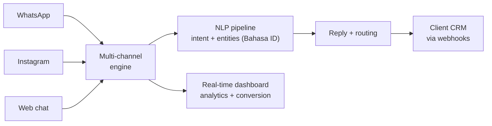

## The Problem

Brands in Indonesia wanted to automate customer interactions across WhatsApp and Instagram, but existing chatbot platforms were expensive, inflexible, and couldn't handle Bahasa Indonesia properly. They needed custom solutions that understood local context.

## What I Built

A multi-tenant chatbot platform at a YC W21 company, building and scaling 30+ chatbots for major brands.

**Core features:**
- **Multi-channel Engine**: WhatsApp, Instagram, and web chat from a single platform
- **NLP Pipeline**: Intent recognition and entity extraction tuned for Bahasa Indonesia
- **Real-time Dashboard**: Bot performance analytics, conversation logs, and conversion tracking
- **Webhook System**: Easy integration with client CRMs and external services

### Client implementations

## Technical Decisions

- **Node.js + TypeScript**: Fast iteration, shared types across the stack
- **Redis caching**: Sub-second response times even at 100k+ messages/day
- **Microservices architecture**: Independent scaling for NLP, message routing, and analytics
- **Infrastructure optimization**: Reduced costs by 40% through caching and resource right-sizing

## Result

- <mark>30+ chatbots shipped for brands across Indonesia</mark>
- **100k+ messages/day** processed with sub-second response times
- **15% week-over-week growth** in gross transaction value
- **40% infrastructure cost reduction** through optimization

**Shows:** Node.js at scale, serverless migration, NLP integrations, infrastructure cost engineering
