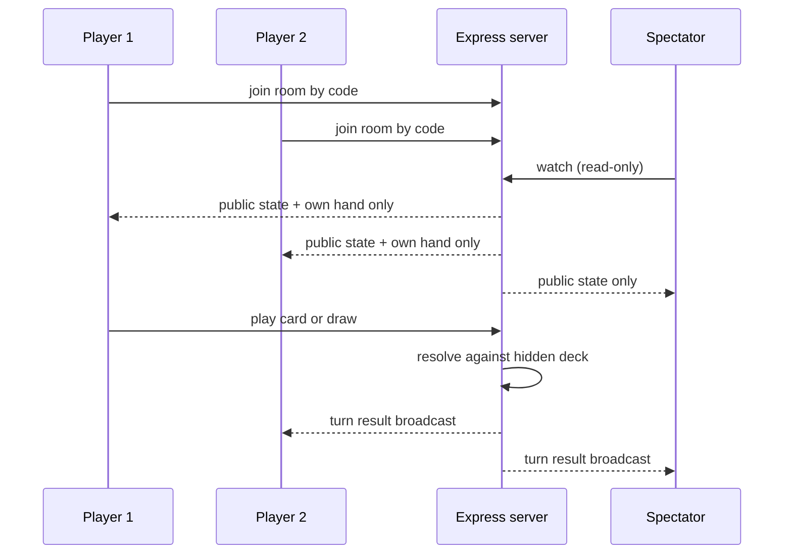

## The Problem

Multiplayer card games look simple and fail in predictable ways: the client cheats, hidden information leaks, and two players see two different versions of reality. Push-your-luck mechanics make it worse — the whole tension is *what you don't know* (deck order, what the next incident is), and any state you expose to the client is state you can't trust.

The team wanted a game that feels snappy for 2-5 players in a private room, with spectators able to watch without breaking anything.

## What I Built

Incident Queue is a turn-based card game where players manage a shared incident queue: play action cards to mitigate risk, but eventually you must draw. Draw a critical incident without mitigation and you're out. Last engineer standing wins.

**Core loop:**

1. **Lobby**: create or join a private room by code (or spectate), 2-5 players, host starts the game
2. **Play phase**: on your turn, play action cards from your hand — Flag Account, Incident Handoff, Legacy System, Pick Up Extra Shifts — or fold and draw from the pile
3. **Draw**: drawing resolves the incident against your mitigations; critical + unmitigated = elimination
4. **Endgame**: turn order can reverse, extra turns stack, and a rollback mechanism covers disputed states

**Screenshots from a live local session:**

## Technical Decisions

- **Server-authoritative by default**: the client renders state it is *given*. Deck order, pending choices, and card ownership never leave the server — hidden information is a server secret, not an obfuscated client variable
- **Socket.IO rooms as the transport**: one connection per player, room-scoped broadcasts, host-only actions (start game) enforced server-side rather than disabled-in-UI
- **TypeScript across the boundary**: shared mental model between `server/` (Express + game engine) and `src/` (React + Vite), with `tsc --noEmit` in CI and a separate server build for single-server production deployment
- **Spectators are first-class**: a Watch mode joins the room with zero write permissions — the UI literally cannot act, and the server rejects it anyway
- **Turn timers and history feed**: each turn is timestamped into a visible feed, so disputes have evidence and the UI can show "Fauzan (Turn 1) · 00:00:02" instead of a bare state

## Result

- **Full loop runs locally**: `npm run dev` brings up Express on :3000 and Vite on :5173; two browser contexts create, join, start, and play a turn end to end (verified — the screenshots above are from that session)
- **3 Playwright e2e flows** covering lobby validation, multiplayer game flow across two browsers, and spectator joins — plus a unit test on timeline export
- **Single-server production build**: `npm run build` compiles server and client together; deploy docs cover Render + CORS split
- **Honest UI**: disabled states say *why* ("Cannot Play", "End play phase"), so the interface teaches the rules instead of hiding them

## Engineering Challenges

**The hardest problem: making hidden information actually hidden.** The tempting shortcut is "don't render it" — leave the deck in the client and filter the view. That leaks to anyone who opens DevTools and turns a game of push-your-luck into a game of reading source. The fix is architectural, not cosmetic: the server owns the deck, computes legal actions, and ships each client only its own hand plus public aggregates (card counts, timers, whose turn).

**Alternatives considered:**

- **Client-side state with server sync** — rejected: every sync boundary is a cheat surface; rollback disputes become unresolvable
- **Polling REST for game state** — rejected: turn-based games still need sub-second feedback on draws and eliminations; WebSockets with room channels are the boring correct answer
- **Rollback as an admin power** — chosen as a visible, logged mechanism instead: the game records turn history so a stuck state can be rewound with evidence, not vibes

## Limitations (documented, not hidden)

- No persistence: rooms live in server memory — a restart ends active games (fine for friends, not for a ranked ladder)
- No matchmaking or accounts; private room codes only
- Reconnect handling is minimal — refresh mid-game and you may rejoin as a new session
- The timeline export is a JSON dump, not a replay format

**Shows:** real-time Socket.IO architecture, server-authoritative game state, TypeScript end-to-end, Playwright e2e across multiple browser contexts