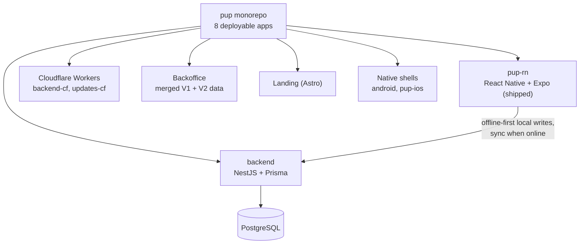
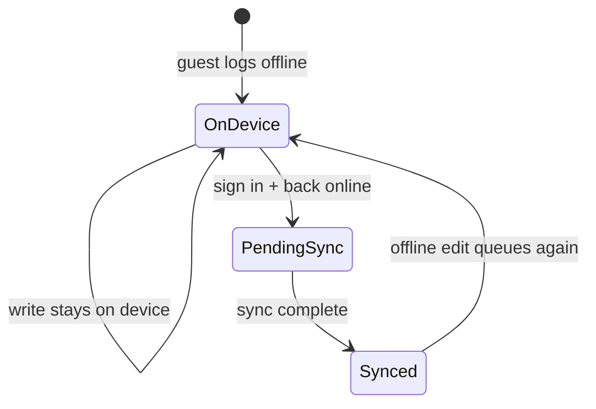

<video src="/projects/pup-brag.mp4" poster="/projects/pup-brag.jpg" controls muted playsinline preload="metadata" width="1920" height="1080"></video>

## The Problem

Health-tracking apps usually demand an account before they'll do anything, then lose your data the moment you're offline — which is exactly when you're standing away from your phone's best network, trying to log something you'd rather not say out loud a second time.

PUP had to be different: log in seconds, work with zero connectivity, keep data private by default, and still offer sync for people who want it across devices.

## What I Built

PUP is a bowel movement tracker — Bristol type, position, duration, optional notes — with a 14-day insight view, streaks, and (in V1) XP, ranks, and achievements. Live on Google Play, with an iOS build in progress.

**The shape of the system** — one monorepo, eight deployable pieces:

| App | Role |
| --- | --- |
| `pup-rn` | React Native + Expo product (Android shipped, iOS pending) |
| `backend` | NestJS + Prisma + PostgreSQL, REST API with docker-compose |
| `backend-cf`, `updates-cf` | Cloudflare Workers services |
| `backoffice` | Internal ops view over merged V1/V2 data |
| `landing` | Astro marketing site + blog (the screenshot above) |
| `android`, `pup-ios` | Native shell/config per platform |

Plus an in-app minigame — because a health tracker people avoid is a failed health tracker:

Data lifecycle for a single log entry:

## Technical Decisions

- **Offline-first, guest-first**: the app opens and logs with no account. Writes land in local storage immediately ("Saved on this device. We will sync when you are online" is a product promise the code has to keep), and sync is an enhancement, not a gate
- **V2 restraint as an engineering decision**: V1 shipped gamification (XP, ranks, leaderboards, Poop Score); V2 strips all of it back to the core loop — log, review, understand. Removing features across an API version (`/api/v2` alongside V1) without breaking live users is harder than adding them
- **Monorepo with hard boundaries**: each app owns its own lockfile and deploy target; the backoffice deliberately reads *merged* V1+V2 data so ops never needs two logins
- **Specs before code**: PRDs live as GitHub issues and markdown in-repo (`OFFLINE_FIRST.md`, `PAYWALL.md`, `PUSH_NOTIFICATIONS_SPEC.md`…) — the handover doc is readable by someone who wasn't in the room
- **Test coverage where it pays**: 67 test files across apps (Jest), including the Worker test harness the V2 plan puts first

## Result

- <mark>Live on Google Play — production users, not a demo</mark>
- Offline logging works with no account; sync, notifications, localization, and accessibility preserved through the V2 redesign
- Eight apps ship from one repo with per-app CI and deploy configs (Render, Cloudflare, Play Store)
- Product direction is documented well enough that V2 could be planned as a numbered delivery plan instead of a vibe

## Engineering Challenges

**The hardest problem: changing the product's soul without stranding users.** V1 is gamified; V2 is deliberately boring — free, no XP, no scores, just the diary. The engineering constraint is coexistence: V1 stays live and untouched while V2 builds behind `/api/v2`, one delivery-plan step at a time, until the branch merges and the store listing updates. Rewriting a live consumer app under its own users is a discipline problem more than a code problem.

**Alternatives considered:**

- **Ship V2 as a separate app** — rejected: splits reviews, ranking, and installs; existing users lose history unless you build migration anyway
- **Big-bang feature flag inside V1** — rejected: V1's gamified data model is entangled with XP and scores; flagging doesn't untangle schema
- **Parallel API version + branch-based delivery** — chosen: V1 keeps serving, V2 grows route-by-route, backoffice merges both views so support never flies blind

**What bit during development:** mobile builds fail in boring ways (icon fonts that only break on asset load, platform-specific native config). The repo's answer is visible in the commit log — pin the dependency, note the reason, keep CI honest.

## Limitations (documented, not hidden)

- V2 is mid-flight on the `v2` branch; the live app is still V1
- iOS is scaffolded (`pup-ios`) but not shipped
- Sync requires sign-in (Google/Apple); guest data stays on-device until then — by design, but it means device loss = data loss for guests
- Expo web is not a supported target; this is a mobile product

**Shows:** offline-first mobile architecture, monorepo delivery, NestJS + Prisma backends, product restraint, shipping to a real store