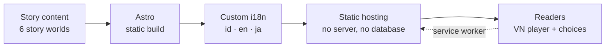

## The Problem

Life skills education (mental health, financial literacy, communication) is usually delivered through lectures, textbooks, or boring compliance modules. Nobody remembers them. Young people in Indonesia needed something engaging that doesn't feel like school.

## What I Built

A free, nonprofit interactive story platform that teaches life skills through visual novel-style stories. Users make choices that shape the narrative, learning by living through scenarios instead of being told what to do.

**Core features:**
- **6 story worlds** covering mental health, relationships, money, digital literacy, communication, and environmental awareness
- **Interactive story engine** with branching narratives and voice acting
- **3 languages** (Indonesian, English, Japanese) with full translation system
- **Story browser** with filters, search, and difficulty levels
- **Dark mode** with system preference detection
- **Offline support** via service worker

### Screenshots

## Technical Decisions

- **Astro** (static output, fast loads, no server needed)
- **Custom i18n system** (data-attribute approach for 3 languages without runtime overhead)
- **Tailwind CSS** (rapid styling with consistent design tokens)
- **No database** (all content static, deployable anywhere)

## Result

<mark>Live at senara.wasmer.app with 6 stories in 3 languages, and growing</mark>. Open source with contribution guidelines for educators and translators to add new stories.

**Shows:** Astro, custom i18n, static content architecture, open-source maintenance
